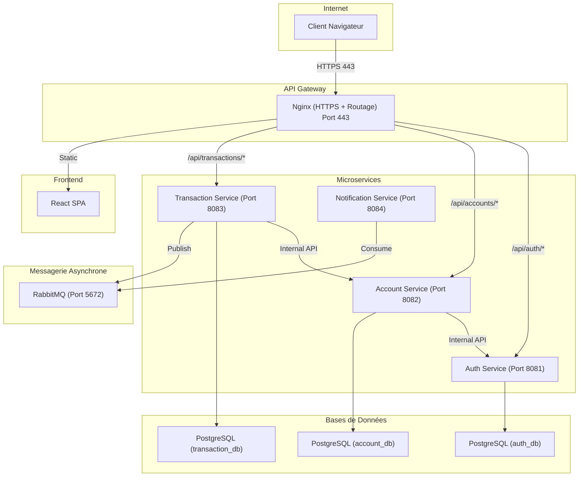

# Architecture Microservices – Portail Bancaire Self-Service

## 1. Vue d'ensemble

L'application est structurée selon une architecture microservices composée de cinq services Spring Boot indépendants, chacun disposant de sa propre base de données PostgreSQL pour garantir l'isolation des données. La communication inter-services s'effectue via des appels REST/HTTP pour les opérations synchrones, et via RabbitMQ pour la gestion asynchrone des événements. Une passerelle API (Nginx) gère le routage, la terminaison HTTPS et la distribution du front-end.

**Points clés de l'architecture :**
- Cinq microservices indépendants (Authentification, Comptes, Transactions, Notifications, Audit).
- Isolation stricte des données (Modèle Database-per-service avec 3 instances PostgreSQL).
- Authentification sans état (stateless) via jetons JWT (JSON Web Tokens).
- Communication asynchrone via un bus d'événements RabbitMQ.
- API Gateway Nginx pour le reverse proxy et le chiffrement TLS.
- Conteneurisation globale via Docker Compose avec sondes de santé (Health Checks).
- Observabilité intégrée via Prometheus, Grafana et cAdvisor.

## 2. Diagramme d'Architecture

## 3. Détail des Microservices

### 3.1 Auth Service (Port 8081)
**Responsabilité :** Authentification, génération des jetons JWT, gestion des profils utilisateurs et traçabilité.

**Composants principaux :**
- `AuthService.java` : Logique de connexion, hachage des mots de passe (BCrypt) et déconnexion.
- `JwtProvider.java` : Génération et validation des jetons JWT.
- `AuditService.java` : Journalisation des événements de sécurité.

**Flux d'authentification :**
1. Validation des identifiants (email/mot de passe).
2. Génération du JWT incluant l'identifiant utilisateur (signé via HMAC-SHA512).
3. Le client transmet ce jeton via l'en-tête `Authorization: Bearer <token>` pour toute requête ultérieure.

### 3.2 Account Service (Port 8082)
**Responsabilité :** Gestion des comptes bancaires et consultation des soldes.

**Points d'attention :**
- Accès restreint via validation du jeton JWT.
- Expose des API internes pour permettre au `Transaction Service` de débiter et créditer les comptes de manière sécurisée.

### 3.3 Transaction Service (Port 8083)
**Responsabilité :** Exécution des virements bancaires, respect des contraintes ACID, publication d'événements.

**Logique de transfert :**
1. Validation du jeton JWT et vérification de la propriété du compte source.
2. Appel HTTP interne vers `Account Service` pour débiter le compte source.
3. Appel HTTP interne vers `Account Service` pour créditer le compte destinataire.
4. Sauvegarde de la transaction en base de données avec statut `COMPLETED`.
5. Publication d'un événement `TransferEvent` sur l'échange RabbitMQ.

### 3.4 Notification Service (Port 8084)
**Responsabilité :** Gestion des notifications utilisateurs (ex: e-mails) en asynchrone.

**Flux :**
1. Écoute de la file d'attente RabbitMQ (`transfer-completed-queue`).
2. À la réception d'un `TransferEvent`, composition du courriel via un template interne.
3. Expédition via le protocole SMTP (ex: serveur mail externe configuré dans le `.env`).

## 4. Architecture des Bases de Données

Afin de respecter le principe "Database-per-service", les bases de données sont physiquement séparées (instances virtuelles distinctes) :

- `auth_db` : Tables `users` et `audit_logs`.
- `account_db` : Table `accounts`.
- `transaction_db` : Table `transactions`.

L'intégrité référentielle inter-domaines n'est pas gérée par des clés étrangères (Foreign Keys) SQL, mais garantie de manière applicative via les appels synchrones (REST) lors des processus métiers.

## 5. Modèle de Sécurité

### 5.1 Gestion des Secrets
Les clés cryptographiques (ex. `JWT_SECRET`) et les mots de passe des bases de données sont injectés via des variables d'environnement (`.env`). Aucun secret n'est intégré dans le code source.

### 5.2 Isolation Réseau
L'ensemble des services (backends, bases de données, broker) opère sur un réseau Docker privé (`banking-network`). Seule l'API Gateway (Nginx) expose les ports 80 et 443 à l'hôte physique, prévenant ainsi toute attaque directe sur les bases de données.

### 5.3 Sécurité des Échanges (TLS)
Nginx centralise la terminaison SSL/TLS, garantissant un chiffrement robuste de bout en bout entre le client final et le portail. Les en-têtes de sécurité HTTP (HSTS, X-Frame-Options) y sont configurés.
