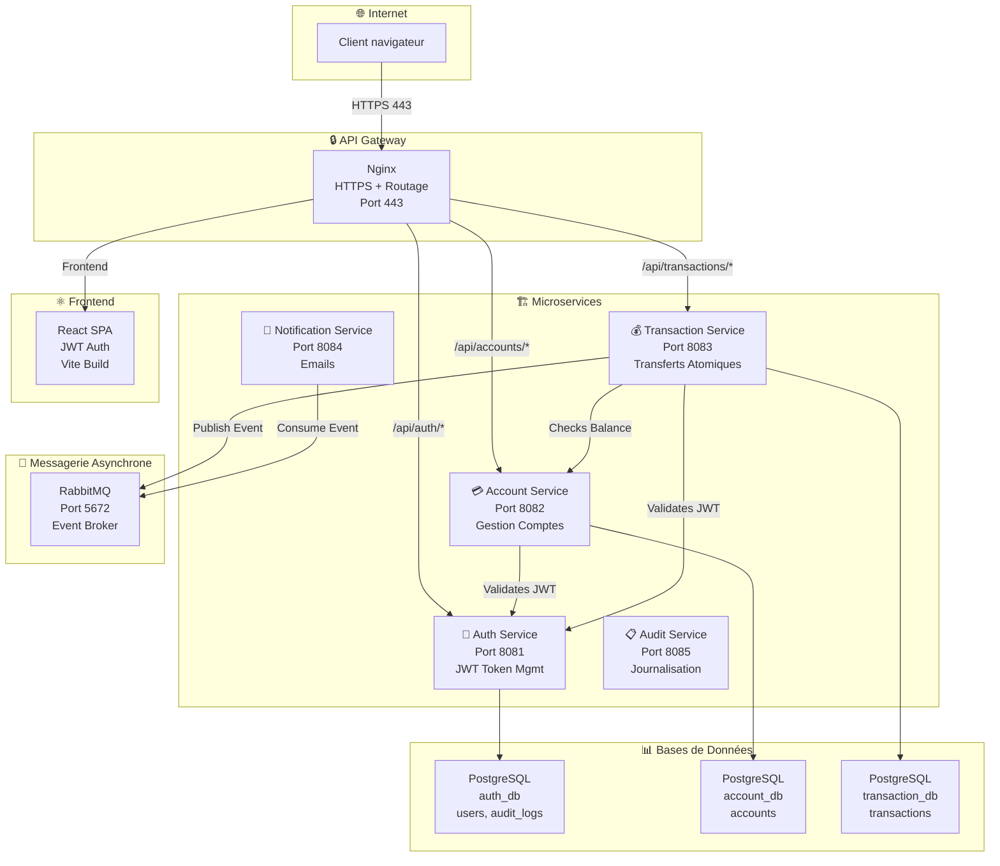

# Architecture Microservices – Portail Bancaire Self-Service

## Vue d'ensemble

L'application a été refactorisée en **architecture microservices** composée de 5 services Spring Boot indépendants, chacun avec sa propre base de données PostgreSQL. Les services communiquent via REST/HTTP pour les opérations synchrones et RabbitMQ pour les événements asynchrones. Une passerelle API Nginx assure le routage, la sécurità HTTPS et la gestion du frontend.

**Points clés:**
- ✅ **5 microservices indépendants** (Auth, Account, Transaction, Notification, Audit)
- ✅ **Base de données isolée par service** (3 instances PostgreSQL)
- ✅ **Authentification JWT sans état** (tokens immuables)
- ✅ **Communication asynchrone** via RabbitMQ (événements de transfert)
- ✅ **API Gateway** Nginx (routage, HTTPS/TLS, rate limiting)
- ✅ **Docker Compose complet** avec health checks et dépendances

## Diagramme d'architecture



## Services Microservices

### 1️⃣ Auth Service (Port 8081)
**Responsabilité:** Authentification, génération JWT, gestion utilisateurs

**Composants clés:**
- `AuthService.java` - Logique de login, validation JWT, logout
- `JwtProvider.java` - Génération/validation tokens JWT (JJWT 0.12.3)
- `UserRepository` - Accès utilisateurs via JPA
- `AuditService` - Journalisation événements sécurité (LOGIN, FAILED_LOGIN, LOGOUT)
- `AuditLog` entity - Stockage audit logs en BD

**Endpoints:**
```
POST   /api/auth/login           → { email, password } → { token, userId, expiresIn }
GET    /api/auth/validate        → { token } → { valid: boolean }
GET    /api/auth/user/{userId}   → Details utilisateur
POST   /api/auth/logout          → { userId }
```

**Flux token JWT:**
1. Client envoie email/password
2. Auth Service valide credentials
3. Génère token JWT avec userId + email en claims
4. Token = `base64(header).base64(payload).base64(signature)` signé avec clé secrète HMAC-SHA512
5. Client stocke token dans localStorage
6. Client ajoute `Authorization: Bearer <token>` à chaque requête

**Base de données:**
```sql
CREATE TABLE users (
  id BIGSERIAL PRIMARY KEY,
  email VARCHAR(255) UNIQUE NOT NULL,
  password_hash VARCHAR(255) NOT NULL,
  first_name VARCHAR(100),
  last_name VARCHAR(100),
  is_active BOOLEAN DEFAULT true,
  created_at TIMESTAMP DEFAULT NOW()
);

CREATE TABLE audit_logs (
  id BIGSERIAL PRIMARY KEY,
  user_id BIGINT REFERENCES users(id),
  event_type VARCHAR(50),         -- LOGIN, FAILED_LOGIN, LOGOUT
  client_ip VARCHAR(45),
  details TEXT,
  timestamp TIMESTAMP DEFAULT NOW()
);
```

---

### 2️⃣ Account Service (Port 8082)
**Responsabilité:** Gestion des comptes bancaires, soldes, informations comptes

**Composants clés:**
- `AccountService.java` - Logique comptes, vérification propriété compte
- `AccountRepository` - Requêtes JPA (findByUserId, etc.)
- `JwtExtractor` - Extraction/validation JWT depuis Authorization header
- `AccountDTO` - Sérialisation réponse

**Endpoints:**
```
GET    /api/accounts              → Liste comptes utilisateur (protégé JWT)
GET    /api/accounts/{id}         → Détails compte
POST   /api/accounts              → Créer compte
PUT    /api/accounts/{id}/balance → Mettre à jour solde (interne)
```

**Sécurité:**
- Tous les endpoints requièrent JWT valide
- Vérification propriété compte : userId du token == userId du compte
- Pas d'accès cross-user possible

**Base de données:**
```sql
CREATE TABLE accounts (
  id BIGSERIAL PRIMARY KEY,
  user_id BIGINT NOT NULL,
  account_number VARCHAR(20) UNIQUE NOT NULL,
  account_type VARCHAR(50),       -- CHECKING, SAVINGS, etc.
  balance DECIMAL(19,2) NOT NULL,
  currency VARCHAR(3) DEFAULT 'EUR',
  is_active BOOLEAN DEFAULT true,
  created_at TIMESTAMP DEFAULT NOW()
);

CREATE INDEX idx_accounts_user_id ON accounts(user_id);
```

---

### 3️⃣ Transaction Service (Port 8083)
**Responsabilité:** Transferts atomiques, gestion transactions, évenements async

**Composants clés:**
- `TransactionService.java` - Logique transfert avec @Transactional (ACID)
- `TransferEventProducer` - Publication événements RabbitMQ
- `TransactionRepository` - Historique transactions
- `RabbitMQConfig` - Configuration consumer queue

**Endpoints:**
```
GET    /api/transactions          → Historique utilisateur
POST   /api/transactions/transfer → Effectuer virement
GET    /api/transactions/{id}     → Détails transaction
```

**Logique transfert (atomique):**
```java
@Transactional
public void transfer(Long fromAccountId, Long toAccountId, BigDecimal amount) {
  // 1. Vérifier JWT + propriété compte sender
  validateSenderOwnership(fromAccountId);

  // 2. Vérifier solde suffisant
  accountService.verifySufficientBalance(fromAccountId, amount);

  // 3. Débiter compte source (SQL: UPDATE ... -amount)
  accountService.debit(fromAccountId, amount);

  // 4. Créditer compte destination (SQL: UPDATE ... +amount)
  accountService.credit(toAccountId, amount);

  // 5. Créer enregistrement transaction (SQL: INSERT)
  transaction.setStatus(TransactionStatus.COMPLETED);
  transactionRepository.save(transaction);

  // 6. Publier événement async (RabbitMQ)
  transferEventProducer.publishTransferCompleted(event);

  // ⚠️ Si exception → ROLLBACK tout (y compris event non publié)
}
```

**Base de données:**
```sql
CREATE TABLE transactions (
  id BIGSERIAL PRIMARY KEY,
  from_account_id BIGINT NOT NULL,
  to_account_id BIGINT NOT NULL,
  amount DECIMAL(19,2) NOT NULL,
  status VARCHAR(50),             -- PENDING, COMPLETED, FAILED
  transaction_date TIMESTAMP DEFAULT NOW()
);

CREATE INDEX idx_transactions_from ON transactions(from_account_id);
CREATE INDEX idx_transactions_to ON transactions(to_account_id);
```

---

### 4️⃣ Notification Service (Port 8084)
**Responsabilité:** Notifications asynchrones (emails), consomme événements RabbitMQ

**Composants clés:**
- `TransferEventListener.java` - @RabbitListener, déclenche sur événement
- `EmailService.java` - Envoie emails SMTP
- `AuthServiceClient` - Récupère email utilisateur depuis Auth Service
- `RabbitMQConfig` - Configure queue consumer

**Flux:**
1. TransactionService publie `TransferEvent` sur RabbitMQ
2. NotificationService écoute `transfer-completed-queue`
3. Déclenche `onTransferCompleted()` → appelle AuthService pour récupérer email
4. Envoie email HTML templé via SMTP

**Contenu email:**
```html
Bonjour {{ firstName }},

Vous avez effectué un virement de {{ amount }} EUR.

De: {{ fromAccountNumber }}
Vers: {{ toAccountNumber }}
Date: {{ timestamp }}
Statut: COMPLÉTÉ

Cordialement,
Votre banque
```

**Configuration SMTP (variables d'env):**
```
SPRING_MAIL_HOST=smtp.gmail.com
SPRING_MAIL_PORT=587
SPRING_MAIL_USERNAME=notifications@bank.com
SPRING_MAIL_PASSWORD=***
```

---

### 5️⃣ Audit Service (Port 8085) [Optionnel]
**Responsabilité:** Journalisation centralisée, analysabilité, conformité

**Note:** Actuellement implémenté dans **Auth Service** (table `audit_logs`). Peut être extrait en service séparé avec:
- Listener RabbitMQ pour événements audit de tous services
- Stockage centralisé audit_db
- Endpoints pour requêtes audit logs (admin)

---

## Flux de Communication

### 1️⃣ Flux Login (Synchrone REST)

```
Client → Nginx → Auth Service
  POST /api/auth/login { email, password }

Auth Service:
  1. Valide email/password
  2. Génère JWT token (HMAC-SHA512)
  3. Log LOGIN event en audit_logs
  4. Retourne { token, userId, expiresIn }

← Token JWT stocké dans localStorage
```

### 2️⃣ Flux Requête API protégée (Synchrone)

```
Client → Nginx → Account Service
  GET /api/accounts
  Authorization: Bearer eyJ...xyz (JWT token)

Nginx:
  - Décode Authorization header
  - Forward vers backend approprié

Account Service:
  1. Extrait token du header
  2. Valide signature JWT avec clé secrète
  3. Vérifie expiration (claims.exp > now)
  4. Extrait userId du token (subject)
  5. Retourne comptes WHERE user_id = userId

← Comptes JSON [ { id, balance, ... } ]
```

### 3️⃣ Flux Virement (Synchrone + Asynchrone)

```
Client → Nginx → Transaction Service
  POST /api/transactions/transfer
  { fromAccountId, toAccountId, amount }
  Authorization: Bearer <token>

Transaction Service (Synchrone):
  1. Valide JWT + propriété compte source
  2. Appelle Account Service (HTTP) pour vérifier solde
  3. Débite compte source (UPDATE)
  4. Crédite compte destination (UPDATE)
  5. Crée enregistrement transaction (INSERT)
  6. COMMIT BD

  → Publie TransferEvent sur RabbitMQ ← (Asynchrone)

Notification Service (Asynchrone):
  1. Écoute RabbitMQ transfer-completed-queue
  2. Reçoit TransferEvent
  3. Appelle Auth Service pour récupérer email
  4. Envoie email SMTP

← Transaction réponse { id, status, timestamp }
```

---

## Architecture Bases de Données

### Isolation par Service (Database-per-Service Pattern)

```
┌─────────────────────────────────────────────┐
│         PostgreSQL: auth_db                 │
│  ┌──────────────┐  ┌──────────────────┐    │
│  │    users     │  │   audit_logs     │    │
│  ├──────────────┤  ├──────────────────┤    │
│  │ id           │  │ id               │    │
│  │ email        │  │ user_id (FK)     │    │
│  │ password_h.. │  │ event_type       │    │
│  │ first_name   │  │ client_ip        │    │
│  │ is_active    │  │ timestamp        │    │
│  └──────────────┘  └──────────────────┘    │
└─────────────────────────────────────────────┘

┌─────────────────────────────────────────────┐
│      PostgreSQL: account_db                 │
│  ┌──────────────┐                          │
│  │   accounts   │                          │
│  ├──────────────┤                          │
│  │ id           │                          │
│  │ user_id (*)  │  (*) foreign_key logique │
│  │ account_num  │      (pas JPA FK)        │
│  │ balance      │                          │
│  │ is_active    │                          │
│  └──────────────┘                          │
└─────────────────────────────────────────────┘

┌─────────────────────────────────────────────┐
│    PostgreSQL: transaction_db               │
│  ┌──────────────────┐                      │
│  │   transactions   │                      │
│  ├──────────────────┤                      │
│  │ id               │                      │
│  │ from_account_id  │ (*)                  │
│  │ to_account_id    │ (*)                  │
│  │ amount           │                      │
│  │ status           │                      │
│  │ timestamp        │                      │
│  └──────────────────┘                      │
└─────────────────────────────────────────────┘
```

**Principes:**
- ✅ Aucune foreign key entre BDs
- ✅ Aucune transaction distribuée (2PC)
- ✅ Références via ID logique seulement
- ✅ Intégrité référentielle maintenue via validations service (HTTP calls)
- ✅ Sauvegarde/restauration indépendante

---

## Composants Système

| Composant | Type | Rôle | Port | Techno |
|-----------|------|------|------|--------|
| Nginx | API Gateway | Routage, HTTPS, rate limiting | 443 | nginx:alpine |
| React Frontend | Web UI | SPA, JWT auth local | interne | node:20 + Vite |
| Auth Service | Microservice | Authentification, JWT, users | 8081 | Spring Boot 3.2 |
| Account Service | Microservice | Comptes bancaires | 8082 | Spring Boot 3.2 |
| Transaction Service | Microservice | Transferts atomiques | 8083 | Spring Boot 3.2 |
| Notification Service | Microservice | Emails async | 8084 | Spring Boot 3.2 |
| Audit Service | Microservice | Journalisation (intégré Auth) | 8085 | Spring Boot 3.2 |
| PostgreSQL Auth | Database | users, audit_logs | interne | postgres:15 |
| PostgreSQL Account | Database | accounts | interne | postgres:15 |
| PostgreSQL Transaction | Database | transactions | interne | postgres:15 |
| RabbitMQ | Message Broker | Events async | 5672 | rabbitmq:3.12 |

---

## Réseaux et Communication Docker

### Réseau Docker: banking-network
```
┌─────────────────────────────────────────┐
│      Docker Network: banking-network     │
├──────────────────┬──────────────────────┤
│ nginx:443        │ Exposed to host      │
│ (reverse proxy)  │                      │
├──────────────────┼──────────────────────┤
│ auth-service:    │ Internal             │
│   8081           │ (DNS: auth-service)  │
├──────────────────┼──────────────────────┤
│ account-service: │ Internal             │
│   8082           │ (DNS: account-svc)   │
├──────────────────┼──────────────────────┤
│ transaction-svc: │ Internal             │
│   8083           │ (DNS: trans-svc)     │
├──────────────────┼──────────────────────┤
│ notification-svc │ Internal             │
│   8084           │ (DNS: notif-svc)     │
├──────────────────┼──────────────────────┤
│ postgres-auth    │ Internal             │
│ postgres-account │ DNS service          │
│ postgres-trans   │ discovery            │
├──────────────────┼──────────────────────┤
│ rabbitmq:5672    │ Internal             │
│        :15672    │ (mgmt)               │
└──────────────────┴──────────────────────┘
```

**Communication réseau:**
```
auth-service → postgres-auth (localhost:5432)
account-service → postgres-account (localhost:5432)
transaction-service → postgres-transaction (localhost:5432)
transaction-service → rabbitmq (rabbitmq:5672)
notification-service → rabbitmq (rabbitmq:5672)
notification-service → auth-service (http://auth-service:8081)
```

---

## Modèle de Sécurité

### Authentification & Autorisation

**JWT Token Stateful:**
```javascript
Header:  { "alg": "HS512", "typ": "JWT" }
Payload: {
  "userId": 123,
  "email": "alice@example.com",
  "iat": 1234567890,
  "exp": 1234571490
}
Signature: HMAC-SHA512(header.payload, secret_key)
```

**Validation flux:**
1. Client → `POST /api/auth/login` avec credentials
2. Auth Service → Valide password avec BCrypt
3. Auth Service → Génère JWT signé avec SECRET_KEY
4. Client → Stocke JWT dans localStorage
5. Client → Ajoute `Authorization: Bearer <JWT>` à requêtes
6. Service → Valide signature JWT avec même SECRET_KEY
7. Service → Extrait userId du token (trusted claim)

**Sécurité du secret:**
- ✅ JWT_SECRET générée avec `openssl rand -base64 32` (256 bits)
- ✅ Stockée dans variable d'env `.env` (jamais en code)
- ✅ Identique dans tous les services pour validation
- ✅ Pas d'exposition sur HTTP (HTTPS obligatoire)

### Contrôle d'Accès (ABC)

**Token JWT contient userId:**
- Account Service vérifie: `token.userId == account.user_id`
- Transaction Service vérifie: `token.userId == account.user_id` (compte source)
- Pas d'accès cross-user possible

**Audit trail:**
- Auth Service logue tous les LOGIN/FAILED_LOGIN/LOGOUT
- IP client captured pour analyse sécurité
- Table audit_logs pour forensics

### HTTPS & TLS

- ✅ Nginx termine TLS 1.3+ (certificats self-signed en dev)
- ✅ HTTP → HTTPS 301 redirect (Nginx)
- ✅ Headers sécurité:
  - `Strict-Transport-Security: max-age=31536000` (HSTS)
  - `X-Frame-Options: DENY` (clickjacking)
  - `X-Content-Type-Options: nosniff` (MIME sniffing)
  - `Content-Security-Policy: default-src 'self'` (XSS)

---

## Données et Persistance

### Volumes Docker

```yaml
services:
  postgres-auth:
    volumes:
      - postgres_auth_data:/var/lib/postgresql/data
      - ./database/auth-init.sql:/docker-entrypoint-initdb.d/schema.sql

  postgres-account:
    volumes:
      - postgres_account_data:/var/lib/postgresql/data
      - ./database/account-init.sql:/docker-entrypoint-initdb.d/schema.sql

  postgres-transaction:
    volumes:
      - postgres_transaction_data:/var/lib/postgresql/data
      - ./database/transaction-init.sql:/docker-entrypoint-initdb.d/schema.sql

volumes:
  postgres_auth_data:
  postgres_account_data:
  postgres_transaction_data:
```

### Sauvegarde & Restauration

**Backup automatique (script):**
```bash
# scripts/backup-db.sh
pg_dump -h postgres-auth -U postgres auth_db > backup_auth.sql
pg_dump -h postgres-account -U postgres account_db > backup_account.sql
pg_dump -h postgres-transaction -U postgres transaction_db > backup_transaction.sql
```

**Restauration:**
```bash
# scripts/restore-db.sh
psql -h postgres-auth -U postgres < backup_auth.sql
# ... repetez pour autres BDs
```

---

## Déploiement Docker Compose

### Structure docker-compose.yml
```yaml
version: '3.8'

services:
  # PostgreSQL × 3
  postgres-auth:
    image: postgres:15-alpine
    environment: DB_NAME=auth_db, DB_USER=postgres, DB_PASSWORD=${DB_PASSWORD}
    ports: (interne)
    volumes: [postgres_auth_data, schema.sql]
    healthcheck: [pg_isready]

  postgres-account:
    # ... similaire

  postgres-transaction:
    # ... similaire

  # RabbitMQ
  rabbitmq:
    image: rabbitmq:3.12-management-alpine
    ports: ["5672:5672", "15672:15672"]
    healthcheck: [rabbitmq-diagnostics status]

  # Microservices × 5
  auth-service:
    build: ./Auth-Service
    ports: ["8081:8081"]
    environment: [JWT_SECRET=${JWT_SECRET}, DB_URL=...]
    depends_on: [postgres-auth]
    healthcheck: [curl /actuator/health]

  account-service:
    build: ./Account-Service
    ports: ["8082:8082"]
    depends_on: [postgres-account]

  transaction-service:
    build: ./Transaction-service
    ports: ["8083:8083"]
    depends_on: [postgres-transaction, rabbitmq]

  notification-service:
    build: ./Notification-Service
    ports: ["8084:8084"]
    depends_on: [rabbitmq, auth-service]

  # Frontend + Nginx
  nginx:
    build: ./Nginx
    ports: ["443:443"]
    volumes: [./nginx/ssl:/etc/nginx/ssl]
    depends_on: [auth-service, ...]

networks:
  banking-network:
    driver: bridge
```

### Démarrage complet
```bash
# 1. Configuration
$ ./scripts/setup.sh      # Génère .env, certificats SSL

# 2. Build images
$ ./scripts/build-all.sh  # docker build pour chaque service

# 3. Démarrage orchestré
$ docker-compose up -d

# 4. Vérification
$ ./scripts/health-check.sh
$ docker-compose ps       # Tous les services "healthy"
```

---

## Points de Défaillance & Résilience

| Scénario | Impact | Mitigation |
|----------|--------|-----------|
| Auth Service down | Toutes requêtes échouent (validation JWT) | Restart auto, health check |
| Account Service down | Impossible consulter comptes | Logs d'erreur 503, retry client |
| Transaction Service down | Transferts impossible | Queue logs transaction avant envoi |
| PostgreSQL down | Perte accès données | Volume persistant, backup régulier |
| RabbitMQ down | Notifications non envoyées | Notifications retentées après redémarrage |
| Nginx down | API inaccessible | Logs frontend, HTTPS non disponible |

**Bonnes pratiques:**
- ✅ Health checks chaque service (tous les 30s)
- ✅ Restart policy: `unless-stopped`
- ✅ Logs centralisés via Docker (stdout)
- ✅ Monitoring (Prometheus optional)

---

## Voir aussi

- [README.md](../README.md) - Guide démarrage rapide
- [exploitation-securite.md](exploitation-securite.md) - Détails sécurité opérationnelle
- [API.md](API.md) - Documentation endpoints (si créé)
- [DEPLOYMENT.md](DEPLOYMENT.md) - Instructions production (si créé)
