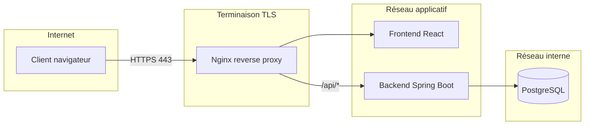

# Schéma d'architecture – Portail Bancaire Self-Service

## Vue d'ensemble

L'application est une stack en conteneurs : reverse proxy (Nginx), frontend React, backend Spring Boot, base PostgreSQL.

## Diagramme d'architecture

## Flux de requêtes

1. **Client** : accès au portail en HTTPS (port 443).
2. **Nginx** : reverse proxy qui termine le TLS, route `/` vers le frontend (fichiers statiques) et `/api/*` vers le backend.
3. **Frontend** : SPA React servie par Nginx (build Vite), appelle l’API via `/api/` (même origine).
4. **Backend** : API REST Spring Boot (authentification session, comptes, transactions), connecté à PostgreSQL.
5. **PostgreSQL** : base de données, **non exposée** sur l’hôte en production (réseau Docker interne).

## Composants

| Composant | Image / Rôle | Port exposé (prod) |
|-----------|----------------|---------------------|
| Nginx | nginx:alpine, proxy + TLS | 80 (redirect), 443 |
| Frontend | Image custom (Node build + nginx) | interne 80 |
| Backend | Image custom (JAR Spring Boot) | interne 8080 |
| PostgreSQL | postgres:16-alpine | aucun (réseau interne) |

## Réseaux Docker

- Tous les services sont sur le réseau par défaut du Compose.
- Seul le service **proxy** expose des ports (80, 443) vers l’hôte.
- La base de données n’a pas de `ports:` en production ; seul le backend y accède.

## Données et persistance

- **Volume** : `postgres_data` monté sur `/var/lib/postgresql/data` du conteneur PostgreSQL. Les données survivent aux redémarrages et aux recréations de conteneurs.
- **Sauvegardes** : script `scripts/backup-db.sh` (pg_dump), à planifier en cron ou depuis un conteneur avec accès au réseau DB.

## Sécurité (résumé)

- HTTPS obligatoire en production (Nginx + certificats).
- Secrets (DB, session) via variables d’environnement.
- API protégée par session (cookie HttpOnly, Secure en prod).
- Journalisation des connexions et accès comptes/transactions (backend).

Voir [exploitation-securite.md](exploitation-securite.md) pour les détails opérationnels et de sécurité.
